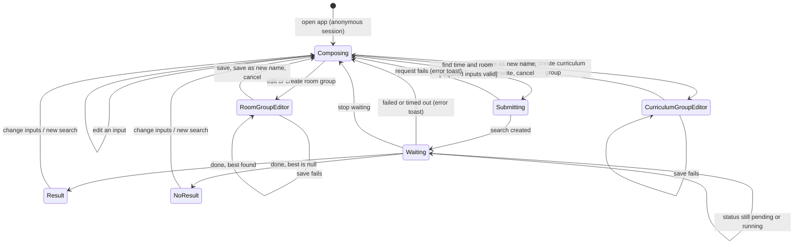
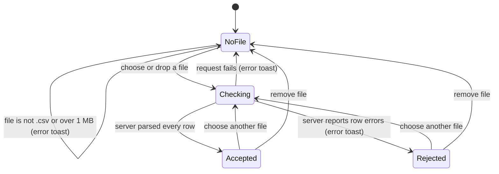

# Search journey (user interface)

Status: explicit (design, not built yet)
Code locations: none yet; the UI for #25, #26, #27, #32 and #33 will hold this state
Decision: explicit by design
Analysis: none

The path of one organiser through the app, from opening it to the result. Screens refer to the frames in [`docs/ui/mockup.md`](../ui/mockup.md); UI-n are the open questions listed there. "Data model" means `docs/data-model.md` (merged with PR #35).

## Diagram

## States

| State | Meaning | Screen | Source |
|---|---|---|---|
| Composing | The search form; initial state. Inputs stay when the user comes back from another state, unless they start a new search. | 01, 03, 04 | [UNDERSTANDING] |
| RoomGroupEditor | Building, ranking and saving a room group | 02 | [REQUIREMENT #25] "Kasutaja saab moodustada ruumi gruppe ise ja luua eelisjärjestuse ruumide osas, neile nime anda ja neid salvestada." |
| CurriculumGroupEditor | Choosing, changing, ranking and saving curricula and courses | 05 | [REQUIREMENT #32] "Kasutaja saab valida kas varem kokkupandud gruppide seast, valida grupi ja tagantjärele muuta seda ning uue nimega salvestada ja eelisjärjekorra õppekavade vahel koostada." |
| Submitting | The search request is being sent | 01 | [UNDERSTANDING] |
| Waiting | The backend collects ASIO data and computes; the loading screen is shown | 06 | [REQUIREMENT #27] "Igaksjuhuks võiks frontend mingi ooteekraani teha kuni backendilt vastust ootab." |
| Result | The best time and room and the groups it does not suit | 07 | [REQUIREMENT #27] "Frontend kuvab backendist saadetud vastuse ja nimekirja gruppidest kellele see aeg ei sobinud." |
| NoResult | The search finished but no time and room fit | 08 D | [UNDERSTANDING] `result.best` is null (data model 5.5) |

There is no final state: the user can always start a new search.

## Transitions

S is the first local (Europe/Tallinn) date of the next semester; its source is UI-2, `PLACEHOLDER(#20)`. A day is in the next semester when its local date is S or later.

| From | Event | Guard | To | Source |
|---|---|---|---|---|
| [*] | open the app | anonymous session exists or is created | Composing | [REQUIREMENT #17] "Kontot pole vaja luua nagu eelmises andmebaas töötab samal põhimõttel." [REQUIREMENT CLAUDE.md] "Users are identified by Supabase anonymous sign-in (`ensureAnonymousSession` in `src/lib/supabase/`)." |
| Composing | edit an input | – | Composing | [UNDERSTANDING] |
| Composing | add a day | local date ≥ S | Composing, warning toast; banner in the time section | [REQUIREMENT #26] "Juhul kui küsitakse andmeid järgmisel poolaastal toimuvate tundide kohta lisa hoiatus" and acceptance criterion "The next-semester warning is shown with toastify." The banner is [UNDERSTANDING] (#17 Unconfirmed decisions). |
| Composing | "Muuda gruppi" or "+ Uus grupp" in Ruumid | – | RoomGroupEditor | [UNDERSTANDING] |
| RoomGroupEditor | save or save under a new name | trimmed name 1–100 characters and not used by the user's other room groups; 1–200 rooms | Composing, success toast, group selected | Saving: [REQUIREMENT #25] "neile nime anda ja neid salvestada". Limits: [UNDERSTANDING] (data model 4.2). |
| RoomGroupEditor | save | name empty, only spaces, over 100 characters or taken; 0 or over 200 rooms; or the request fails | RoomGroupEditor, error toast, changes kept | [UNDERSTANDING] |
| RoomGroupEditor | cancel | – | Composing, saved group unchanged | [UNDERSTANDING] |
| Composing | "Muuda gruppi" or "+ Uus grupp" in Õppekavad | – | CurriculumGroupEditor | [UNDERSTANDING] |
| CurriculumGroupEditor | save under a new name | name rules as for room groups; 1–200 curricula | Composing, success toast, both groups exist | Saving: [REQUIREMENT #32] "uue nimega salvestada". Limits: [UNDERSTANDING] (data model 4.2). |
| CurriculumGroupEditor | overwrite the source group | same as above | Composing, success toast | [UNDERSTANDING] |
| CurriculumGroupEditor | save or overwrite | name invalid or taken; 0 or over 200 curricula; or the request fails | CurriculumGroupEditor, error toast, changes kept | [UNDERSTANDING] |
| CurriculumGroupEditor | cancel | – | Composing, saved group unchanged | [UNDERSTANDING] |
| Composing | "Leia aeg ja ruum" | at least one room; at least one valid time range; event type and duration set | Submitting | Rooms and time ranges: [REQUIREMENT #23] "Punktid 1.1 ja 1.2 on alati nõutud, 1.3 ja 1.4 on valikulised ning iga kombinatsioon neist on lubatud kaasaarvatud tühihulk." Event type and duration: [UNDERSTANDING] (data model 4.3, Q8). Whether an accepted CSV alone counts as a time range is UI-9; working assumption yes, from [REQUIREMENT #33] "Alternatiivselt saab 1.2) asemel kindla struktuuriga csv faili üles laadida". |
| Composing | "Leia aeg ja ruum" | a required input is missing or the CSV is in Checking | Composing, button disabled, missing items listed | [UNDERSTANDING] |
| Submitting | search created | – | Waiting | [UNDERSTANDING] |
| Submitting | request fails | – | Composing, error toast, inputs kept | Toast: [REQUIREMENT #27] "errors as toastify warnings" (acceptance criterion). Inputs kept: [UNDERSTANDING]. |
| Waiting | status check | `pending` or `running` | Waiting | [UNDERSTANDING] (data model `searches.status`) |
| Waiting | status check | `done` and `result.best` is set | Result | [UNDERSTANDING] |
| Waiting | status check | `done` and `result.best` is null | NoResult | [UNDERSTANDING] |
| Waiting | status check | `failed`, or no answer after 2 minutes | Composing, error toast, inputs kept | [UNDERSTANDING] (UI-3) |
| Waiting | "Katkesta ootamine" | – | Composing, inputs kept | [UNDERSTANDING] |
| Result | "Muuda sisendeid" | – | Composing with the same inputs | [UNDERSTANDING] |
| Result | "Uus otsing" | – | Composing, empty inputs | [UNDERSTANDING] |
| NoResult | "Muuda sisendeid" | – | Composing with the same inputs | [UNDERSTANDING] |
| NoResult | "Uus otsing" | – | Composing, empty inputs | [UNDERSTANDING] |

## CSV upload (inside Composing)

The backend parses the file (#31, UI-8); the UI only shows its answer.

| State | Meaning | Source |
|---|---|---|
| NoFile | No CSV; initial state | [UNDERSTANDING] |
| Checking | The file is sent to the backend for checking | [UNDERSTANDING] (UI-8) |
| Accepted | Every row is valid; the ranges are used instead of, or together with, the manual ones | [REQUIREMENT #33] "Alternatiivselt saab 1.2) asemel kindla struktuuriga csv faili üles laadida, mida backend selle asemel või koos sellega töötlema hakkab." |
| Rejected | The backend reported row errors; the file is not used | [UNDERSTANDING] |

| From | Event | Guard | To | Source |
|---|---|---|---|---|
| NoFile | choose or drop a file | extension `.csv` and at most 1 MB | Checking | [UNDERSTANDING] (1 MB is an unconfirmed limit) |
| NoFile | choose or drop a file | not `.csv`, or over 1 MB | NoFile, error toast | [UNDERSTANDING] |
| Checking | answer | every row valid | Accepted | [UNDERSTANDING] |
| Checking | answer | row errors | Rejected, error toast naming the rows | [REQUIREMENT #33] "errors shown as toastify warnings" (acceptance criterion) |
| Checking | request fails | – | NoFile, error toast | [UNDERSTANDING] |
| Accepted | choose another file | – | Checking, the old file is replaced | [UNDERSTANDING] |
| Accepted | remove file | – | NoFile | [UNDERSTANDING] |
| Rejected | choose another file | – | Checking | [UNDERSTANDING] |
| Rejected | remove file | – | NoFile | [UNDERSTANDING] |

## Unknowns

- Waiting + "Katkesta ootamine": does the search keep running on the server, and can the user return to it? (UI-3)
- Waiting, Submitting or Result + page reload or closed tab: can the UI resume by search id, for example `/otsing/<id>`?
- Submitting + the button pressed twice: the UI sends one search, but does the backend need an idempotency key?
- Any state + anonymous session lost (new browser, cleared site data): saved groups are not visible any more. Is a warning needed?
- An editor + leaving with unsaved changes (header link, browser back): ask, or discard?
- Composing + the same group edited in two tabs: which save wins?
- Composing + days in two semesters at once: one warning, or one per day?
- Composing + a range that does not exist in local time (29 March 2026 03:00–03:59, when clocks jump forward).
- Accepted + manual times with "Kasuta koos käsitsi sisestatud aegadega" off: the CSV replaces them; is that clear enough to the user?
- Accepted + manual times: does the UI show the union of the ranges (data model 5.4 says the solver takes the union)?
- Rejected + valid manual times: the search can run with the manual times only; should the UI ask first?
- Result + `result.warnings` contains `next_semester` (data model 5.5): shown as a toast and in the warnings box, or only in the box?
- CurriculumGroupEditor + the ASIO catalogue is slow or fails (data model Q6, #21): what does the list show?
