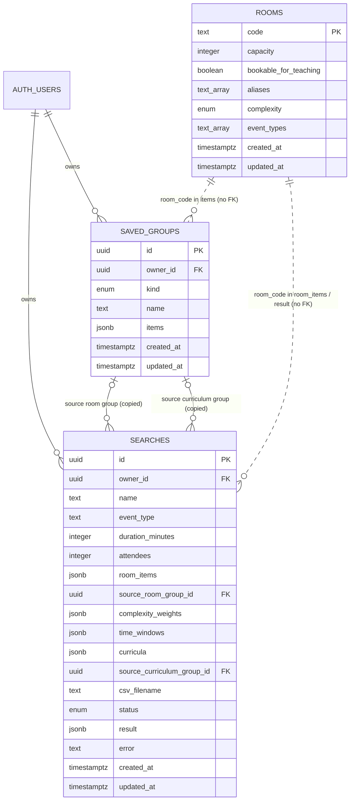

# Data model

Status: proposal for issue #6. Everything marked **Unconfirmed** is a working assumption by the database & quality role. The backend role confirms or changes it in the Pull Request review (Standing rule 10).

## 1. Summary

The database stores three things:

| Table | What it holds | Who writes |
|---|---|---|
| `rooms` | The room catalogue: code, capacity, teaching flag, name aliases, acquisition complexity class, suitable event types. | Seed data and server code with the service role. Clients only read. |
| `saved_groups` | A user's saved, named and ranked groups: room groups (1.1) and curriculum and course groups (1.3). | The owner (`auth.uid()`). |
| `searches` | One search: a snapshot of every input (rooms, complexity weights, event type, nested time windows, curricula, CSV file name) and its status and result. | The owner creates it; the server code writes the status and the result. |

Lists, rankings and the nested time intervals are `jsonb` inside these rows. Data that changes often in ASIO (room bookings, class times) and the curriculum and course catalogue are not stored; the scraper reads them live.

## 2. Requirements coverage

Source: the team task description (backend role), quoted in issue #6 and in the issues it links. "Not in the database" means the requirement is met elsewhere; the reason is given.

| # | Requirement (short) | Where it is covered |
|---|---|---|
| 0 | No user accounts, same principle as the previous project | Supabase anonymous sign-in; every user-owned row has `owner_id = auth.uid()` with row level security (section 6). |
| 0 | Frontend uses Toastify for warnings | Not in the database: frontend only. |
| 0 | Loading screen while waiting for the backend | Not in the database as a feature, but `searches.status` (`pending`, `running`, `done`, `failed`) lets the frontend show it and poll if the search runs asynchronously. |
| 0 | UTC only | Every time column is `timestamptz`; every time inside `jsonb` is an ISO 8601 UTC string ending in `Z`, checked by the database (section 8). |
| 1 | User forms room groups, ranks rooms, names and saves them | `saved_groups` with `kind = 'room'`, `name`, `items` (array order = rank). |
| 1.1 | Room capacity | `rooms.capacity`. Used against `searches.attendees` (**Unconfirmed** addition). |
| 1.1 | Room code | `rooms.code` (primary key). |
| 1.1 | Bookable for teaching | `rooms.bookable_for_teaching`. |
| 1.1 | Name variants for search, many to one | `rooms.aliases text[]` with a GIN index; a trigger rejects an alias already used by another room, so each alias belongs to exactly one room. |
| 1.1 | Acquisition complexity class (Google Form, institute permission, university permission, write to owner, other) | `rooms.complexity`, enum `room_acquisition_complexity`. |
| 1.1 | User-adjustable weight 0–1, rounded float | `searches.complexity_weights` (one weight per complexity class, 0–1, at most 2 decimals, checked by the database). Defaults are a code constant (**Unconfirmed**, section 9). |
| 1.1 | Link to an existing event type (e.g. meeting) or add a new type for next time | `searches.event_type` (free text, trimmed); a new type exists once a search uses it. `rooms.event_types` links rooms to types (**Unconfirmed**). |
| 1.1 | Event types ordered by popularity in the UI | Function `event_type_popularity()` returns only `(event_type, use_count)`: the types in `rooms.event_types`, types used by at least 2 different users, and the caller's own types; `use_count` counts all users' searches (section 4.4). |
| 1.2 | Time tool: several days, several ranges per day | `searches.time_windows`: period → day → range → slot (section 5.4). |
| 1.2 | Warning when the request concerns next semester's classes | Not in the database: the semester start date is a code constant or environment variable, `PLACEHOLDER(#20)`, or the backend reads it from ASIO (open question). The warning is shown by the frontend; the backend may also return it in `searches.result.warnings`. |
| 1.3 | Optionally choose curricula and courses (structure as in ASIO) | `searches.curricula` (snapshot of the choice, ranked). The catalogue itself is read live from ASIO (**Unconfirmed**, open question). |
| 1.3 | Choose an earlier group, change it, save under a new name | `saved_groups` with `kind = 'curriculum'`; "save under a new name" inserts a new row. Unique name per owner and kind. |
| 1.3 | Rank curricula | Array order in `saved_groups.items` and `searches.curricula`. |
| 1.3 | A curriculum = university, building, institute, degree level, speciality, track | Fields of a curriculum item (section 5.2). |
| 1.4 | Upload a CSV instead of or together with 1.2 | The backend parses the CSV into the same `searches.time_windows` tree (period `source = 'csv'`) and stores `searches.csv_filename`. The raw file is not kept (**Unconfirmed**), so no storage bucket. |
| 1.4 | "The backend reads the CSV and saves it to the database" | Parsed rows are saved in `searches.time_windows`. |
| Matching | 1.1 and 1.2 always required, 1.3 and 1.4 optional, every combination incl. none | `room_items` and `time_windows` are `not null` and non-empty; `curricula` and `csv_filename` are nullable. 1.4 "instead of 1.2" is read as: the CSV fills the same required time windows. |
| Matching | 4 recursive, nested time intervals, each 1:N to its children | `time_windows` tree with 4 levels; the database checks start < end, child inside parent, UTC, and no fifth level. |
| Matching | Find the time that suits as many as possible, by the rankings of rooms and curricula | Inputs: `room_items`, `curricula` (ranked), `complexity_weights`, `time_windows`. The algorithm is not in the database (backend). |
| 2 | Scraper collects frequently changing data from ASIO (bookings, class times) | Not in the database: the backend role decided the scraper does not touch the database. A cache is a backend decision. |
| 2 | Google OR-Tools picks the best time and room; sent to the frontend | The answer is stored in `searches.result.best` and returned to the frontend. The solver itself is backend. |
| 3 | Frontend shows the answer and the groups the time did not suit | `searches.result.best` and `searches.result.unsuitable_groups`. |

Every row maps to a table, a column, a function or a stated reason.

## 3. ERD



Dotted lines are references inside `jsonb`. They are not foreign keys on purpose: groups and searches keep a room code even if the room is later removed from the catalogue, and the application validates codes on save.

## 4. Tables

Common to all tables: `created_at timestamptz not null default now()`, `updated_at timestamptz not null default now()` kept current by a `before update` trigger, row level security enabled. Text columns have length checks so that a client cannot store unbounded data.

### 4.1 `rooms`

| Column | Type | Null | Default | Checks and notes |
|---|---|---|---|---|
| `code` | `text` | PK | – | 1–32 characters, no surrounding spaces. ASIO room code. |
| `capacity` | `integer` | not null | – | `capacity > 0`. |
| `bookable_for_teaching` | `boolean` | not null | `false` | |
| `aliases` | `text[]` | not null | `'{}'` | No null or empty elements, each trimmed and 1–100 characters, at most 20. Unique across rooms (trigger). GIN index. |
| `complexity` | `room_acquisition_complexity` | not null | `'other'` | Enum: `google_form`, `institute_permission`, `university_permission`, `contact_owner`, `other`. |
| `event_types` | `text[]` | not null | `'{}'` | Event types the room suits (**Unconfirmed**). Same element rules as `aliases`, 1–60 characters. |

Alias search: `aliases @> array['A-543']` uses the GIN index. Partial, case-insensitive search runs in the client over the small catalogue.

### 4.2 `saved_groups`

| Column | Type | Null | Default | Checks and notes |
|---|---|---|---|---|
| `id` | `uuid` | PK | `gen_random_uuid()` | Also `unique (id, owner_id)` for the same-owner foreign keys from `searches`. |
| `owner_id` | `uuid` | not null | `auth.uid()` | FK `auth.users(id) on delete cascade`. |
| `kind` | `saved_group_kind` | not null | – | Enum: `room`, `curriculum`. |
| `name` | `text` | not null | – | 1–100 characters, trimmed. `unique (owner_id, kind, name)` (**Unconfirmed**). |
| `items` | `jsonb` | not null | – | JSON array, 1–200 elements; array order is the rank (index 0 = first choice). Shape per `kind` in section 5. |

Index: the unique constraint `(owner_id, kind, name)` also serves "list my groups of a kind".

### 4.3 `searches`

| Column | Type | Null | Default | Checks and notes |
|---|---|---|---|---|
| `id` | `uuid` | PK | `gen_random_uuid()` | |
| `owner_id` | `uuid` | not null | `auth.uid()` | FK `auth.users(id) on delete cascade`. |
| `name` | `text` | null | – | Optional label, 1–100 characters, trimmed. |
| `event_type` | `text` | not null | – | 1–60 characters, trimmed (`btrim(event_type) = event_type`). Grouped case-insensitively by `event_type_popularity()`. |
| `duration_minutes` | `integer` | not null | – | 5–1440. **Unconfirmed** addition: the solver cannot choose a time without the event length. |
| `attendees` | `integer` | null | – | 1–10000. **Unconfirmed** addition: makes `rooms.capacity` usable. |
| `room_items` | `jsonb` | not null | – | Snapshot of the room group at search time; array, 1–200 elements. |
| `source_room_group_id` | `uuid` | null | – | FK `(source_room_group_id, owner_id)` → `saved_groups(id, owner_id) on delete set null (source_room_group_id)`: only the owner's own group can be referenced. |
| `complexity_weights` | `jsonb` | not null | `'{}'` | Object; keys are complexity enum values; values are numbers 0–1 with at most 2 decimals. A missing key means the code default. |
| `time_windows` | `jsonb` | not null | – | The 4-level tree (section 5.4), validated by `is_valid_time_windows()`; at most 256 kB. |
| `curricula` | `jsonb` | null | – | 1.3 snapshot; null = not used. When present, an array of 1–200 elements. |
| `source_curriculum_group_id` | `uuid` | null | – | Same-owner FK as `source_room_group_id`. |
| `csv_filename` | `text` | null | – | 1–255 characters; null = no CSV. |
| `status` | `search_status` | not null | `'pending'` | Enum: `pending`, `running`, `done`, `failed`. |
| `result` | `jsonb` | null | – | Set by the server code. Check: `status = 'done'` ⇔ `result is not null`. |
| `error` | `text` | null | – | Up to 1000 characters. Check: `status = 'failed'` ⇔ `error is not null`. |

Index: `(owner_id, created_at desc)` for "my searches". `event_type_popularity()` reads and groups every row anyway, so an index on `lower(event_type)` would not help it and is not created.

**Snapshot instead of reference.** `room_items` and `curricula` are copies, and `source_*_group_id` only remembers where they came from. A saved group can be edited or deleted later, but a search must stay exactly as it was run, so its result can still be explained.

### 4.4 Function `event_type_popularity()`

`returns table (event_type text, use_count bigint)`, `language sql`, `stable`, `security definer`, `set search_path = ''`. No parameters. It counts `searches.event_type` across all users (grouped by `lower()`, showing the most common spelling) and adds every `rooms.event_types` value with count 0, so that seeded types such as `koosolek` exist before the first search. Ordered by `use_count desc, event_type`. It never returns ids, owners, names or times.

`event_type` is free text, so a type typed by one user must not leak to others (**Unconfirmed decision**, Q12). A type is returned only when it is:

- seeded (in `rooms.event_types`), or
- used by at least 2 different owners, or
- used by the caller (`owner_id = auth.uid()`).

`use_count` still counts the searches of all users. A new type therefore appears to its author at once and to everyone once a second user picks it.

Privileges: `revoke execute` from `public` and `anon`, `grant execute` to `authenticated` only.

### 4.5 Function `is_valid_time_windows(jsonb)`

`returns boolean`, `immutable`. Used in the `searches.time_windows` check (section 5.4).

Every `start` and `end` must be a JSON string matching exactly one format:

```
^\d{4}-\d{2}-\d{2}T\d{2}:\d{2}:\d{2}Z$
```

Rejected, among others: milliseconds (`…08:00:00.000Z`), any offset other than `Z` (`…08:00:00+02:00`, `…+00:00`), a lowercase `z`, a space instead of `T`, a date without a time, and missing seconds. Because only this one fixed-width, zero-padded UTC format is accepted, comparing the strings byte by byte orders them exactly like the instants they represent. The comparisons use the `"C"` collation (`collate pg_catalog."C"`), so the order does not depend on the database locale. So start/end order and nesting are checked with text comparison, with no cast to `timestamptz`, no dependence on the session time zone, and an honest `immutable` label. Tests cover each rejected form.

## 5. JSON shapes

The TypeScript types below describe the JSON; the generated `src/lib/supabase/database.types.ts` types these columns only as `Json`. Typed helpers and the application's validation (zod or similar) are a backend decision. The database checks the structure that protects integrity; the application gives friendly error messages.

### 5.1 Room item (`saved_groups.items` when `kind = 'room'`, `searches.room_items`)

```ts
type RoomItem = { room_code: string };
type RoomItems = RoomItem[]; // index 0 = most preferred
```

```json
[{ "room_code": "A-543" }, { "room_code": "M-213" }]
```

### 5.2 Curriculum item (`saved_groups.items` when `kind = 'curriculum'`, `searches.curricula`)

```ts
type CourseRef = { code: string; name: string };
type CurriculumItem = {
  asio_id?: string;        // ASIO identifier, if the scraper needs it (Unconfirmed)
  university: string;      // "TLÜ"
  building: string;        // "Peahoone"
  institute: string;       // "DTI"
  degree_level: string;    // "Bakalaureuseõpe"
  programme: string;       // eriala, "Informaatika"
  specialisation?: string; // suund, "Tarkvaraarendus"
  courses?: CourseRef[];   // absent or empty = the whole curriculum
};
type CurriculumItems = CurriculumItem[]; // index 0 = most important not to overlap
```

```json
[
  {
    "university": "TLÜ",
    "building": "Peahoone",
    "institute": "DTI",
    "degree_level": "Bakalaureuseõpe",
    "programme": "Informaatika",
    "specialisation": "Tarkvaraarendus",
    "courses": [{ "code": "IFI6001.DT", "name": "Example course" }]
  }
]
```

### 5.3 Complexity weights (`searches.complexity_weights`)

```ts
type Complexity = "google_form" | "institute_permission" | "university_permission" | "contact_owner" | "other";
type ComplexityWeights = Partial<Record<Complexity, number>>; // 0–1, 2 decimals; missing = default
```

```json
{ "google_form": 1, "university_permission": 0.25 }
```

Meaning (**Unconfirmed**): 1 = no penalty, 0 = avoid this class. Default constant: `google_form` 1.00, `contact_owner` 0.70, `institute_permission` 0.60, `university_permission` 0.40, `other` 0.30.

### 5.4 Time windows (`searches.time_windows`)

Four nested levels, each a real interval with its own `start` and `end`, each 1:N to its children. Level names (**Unconfirmed**): period → day → range → slot.

```ts
type UtcInstant = string; // "2026-12-01T08:00:00Z"
type Interval = { start: UtcInstant; end: UtcInstant };
type Slot = Interval;                                  // level 4: an exact candidate time
type Range = Interval & { slots?: Slot[] };            // level 3: a possible time range in a day
type Day = Interval & { ranges: Range[] };             // level 2: a possible day
type Period = Interval & { source: "tool" | "csv"; days: Day[] }; // level 1
type TimeWindows = Period[];
```

```json
[
  {
    "source": "tool",
    "start": "2026-11-30T22:00:00Z",
    "end": "2026-12-04T22:00:00Z",
    "days": [
      {
        "start": "2026-11-30T22:00:00Z",
        "end": "2026-12-01T22:00:00Z",
        "ranges": [
          { "start": "2026-12-01T08:00:00Z", "end": "2026-12-01T12:00:00Z" },
          {
            "start": "2026-12-01T13:00:00Z",
            "end": "2026-12-01T16:00:00Z",
            "slots": [{ "start": "2026-12-01T14:00:00Z", "end": "2026-12-01T15:30:00Z" }]
          }
        ]
      }
    ]
  }
]
```

A "day" is the user's local (Europe/Tallinn) day expressed in UTC, so 1 December in winter is `2026-11-30T22:00:00Z` to `2026-12-01T22:00:00Z`; the frontend converts at the display boundary. Without slots the backend generates candidates of `duration_minutes` inside each range.

Rules and who checks them:

| Rule | Database (`is_valid_time_windows`) | Application |
|---|---|---|
| Root is a non-empty array (1–50 periods); days, ranges per parent 1–200; slots 0–200 | yes | yes |
| Only the keys above; no fifth level | yes | yes |
| Every time matches exactly `^\d{4}-\d{2}-\d{2}T\d{2}:\d{2}:\d{2}Z$` (UTC, no milliseconds, no other offset; see 4.5) | yes | yes, converts from local time and formats to this string |
| `start < end` on every node | yes | yes |
| A child lies inside its parent (`parent.start <= child.start`, `child.end <= parent.end`) | yes | yes |
| `source` is `tool` or `csv` | yes | yes |
| Siblings do not overlap, ranges at least `duration_minutes` long | no (overlaps are harmless: the solver takes the union) | backend decision |
| The date is a real calendar date (no 30 February) | no | yes |

### 5.5 Result (`searches.result`)

```ts
type Result = {
  best: { room_code: string; start: UtcInstant; end: UtcInstant; score: number } | null; // null = nothing fits
  unsuitable_groups: {
    curriculum: CurriculumItem;   // or the course that conflicts
    course?: CourseRef;
    conflicts: Interval[];         // its class times that overlap best
  }[];
  warnings?: ("next_semester")[];
};
```

```json
{
  "best": { "room_code": "A-543", "start": "2026-12-01T14:00:00Z", "end": "2026-12-01T15:30:00Z", "score": 0.92 },
  "unsuitable_groups": [
    {
      "curriculum": { "university": "TLÜ", "building": "Peahoone", "institute": "DTI", "degree_level": "Bakalaureuseõpe", "programme": "Informaatika" },
      "conflicts": [{ "start": "2026-12-01T14:15:00Z", "end": "2026-12-01T15:45:00Z" }]
    }
  ],
  "warnings": []
}
```

The database only checks that `result` is a JSON object; its content belongs to the backend and is documented here for the frontend.

## 6. Row level security

- **Anonymous sign-in.** Users never create accounts. `ensureAnonymousSession` gives every browser its own `auth.uid()` and the `authenticated` role. The `anon` role (no session) gets no table access and cannot run `event_type_popularity()`.
- **Privileges first, policies second.** As in the previous project, Supabase's default `grant all` to `anon` and `authenticated` is revoked and only the needed privileges are granted, so a wrong policy cannot expose more.
- **Service role** bypasses RLS and is used only in server code (`src/lib/supabase/` server client with a secret key from the environment, never in the repository or the client).

| Table | `authenticated` privileges | Policies |
|---|---|---|
| `rooms` | `select` | Everyone signed in can read. No insert, update or delete from clients. |
| `saved_groups` | `select`, `insert`, `update (name, items)`, `delete` | All four: `owner_id = (select auth.uid())`. Another user's rows are invisible and unchangeable. |
| `searches` | `select`, `insert`, `update (name)`, `delete` | All four: owner only. The insert check also requires `status = 'pending'`, `result is null`, `error is null`, so a client cannot fake a result. `status`, `result`, `error` are changed by the server code with the service role. |

`event_type_popularity()` is `security definer` so it can count across all users, and it returns only aggregates (section 4.4). It is the only way to see anything derived from other users' searches.

## 7. Data sources

| Data | Source |
|---|---|
| `rooms` | Development: `supabase/seed.sql` (sample rooms marked as sample data, fictional codes allowed). Production: open question; working assumption a versioned data migration or a server-side upsert with the service role. |
| `saved_groups` | The user, through the frontend (directly with RLS or through backend Server Actions, backend decision). |
| `searches` inputs | The user (1.1–1.3) and the backend (1.4: parsed CSV into `time_windows`, `csv_filename`). |
| `searches.status`, `result`, `error` | The backend with the service role, after the scraper and the solver run. |
| Bookings and class times | ASIO, read live by the scraper; not stored. |
| Curriculum and course catalogue | ASIO, read live by the scraper (**Unconfirmed**); only the user's choices are stored. |
| Default complexity weights, semester start | Code constants or environment variables: weights `PLACEHOLDER(#22)`, semester start `PLACEHOLDER(#20)`. |

## 8. Time rules

- Every time column is `timestamptz`; every time inside `jsonb` is an ISO 8601 UTC string in exactly the form `YYYY-MM-DDTHH:MM:SSZ` (whole seconds, `Z`, no milliseconds, no other offset), enforced by `is_valid_time_windows()` for `time_windows`.
- The server computes in UTC. Tests and CI run with `TZ=UTC`.
- Europe/Tallinn appears only in the user interface; the frontend converts at that boundary, including across daylight saving changes (e.g. a local day is 23 or 25 hours long on the change dates, which the day interval represents exactly).
- Tests cover midnight, day, week and year edges and the 2026 daylight saving dates (a 23-hour and a 25-hour local day).

## 9. Open questions

| # | Question | Working assumption (**Unconfirmed**) | Who answers |
|---|---|---|---|
| Q1 | What are the four nested interval levels? | period → day → range → slot (each a real interval). Issue #6 proposed search → day → range → candidate slot; the search row has no interval of its own, so a period level replaces it. | Backend |
| Q2 | CSV columns | One row = one range: `date,start,end` in UTC ISO 8601 (issue #6); optional fourth/fifth columns `slot_start,slot_end`. The backend groups rows into periods and days. | Backend |
| Q3 | Default complexity weights and meaning | 1 = no penalty, 0 = avoid; values in 5.3; one weight per class per search, no per-room override. | Backend |
| Q4 | Are `rooms.event_types` needed? | Yes, to link a room to suitable event types and to seed the popularity list; can be dropped if unused. | Backend |
| Q5 | Source of semester dates for the next-semester warning | Code constant or environment variable `PLACEHOLDER(#20)`, or read from ASIO. Not a table. | Backend |
| Q6 | Source of the curriculum and course list | Read live from ASIO by the scraper; the database stores only the user's choices. | Backend |
| Q7 | History of results | Searches stay until the owner deletes them; no automatic clean-up. | Team |
| Q8 | Event length and attendee count | New columns `duration_minutes` (required) and `attendees` (optional); not in the task text but needed by the solver and the capacity data. | Backend |
| Q9 | Production room catalogue | Seed for development; production by a data migration or a service-role upsert. | Backend |
| Q10 | Does the search run asynchronously? | Yes (status enum); a synchronous run simply writes `done` at once. | Backend |
| Q11 | Does the backend save the search result in the database (`searches.status`, `result`, `error` with the service role) or only send it to the frontend? | It saves it with the service role: safe, because the client cannot fake a result (clients have no update privilege on these columns). The service role key is used only in server code and never reaches the client or the repository. | Backend |
| Q12 | Which event types may a user see? | Seeded types, types used by at least 2 different users, and the user's own types; `use_count` counts all users. A single user's free text never reaches others. | Team |

### Differences from the earlier working assumptions in issue #6

Reported, not silently overridden (Standing rule 1):

| Issue #6 / linked issues | This model | Reason |
|---|---|---|
| About 10–12 tables (risk in #6) | 3 tables, lists in `jsonb` and arrays | Lecturer's guidance on table count; the user's instruction. |
| Weight per complexity class, overridable per room in a group (#6, #8) | One weight per class, per search | The task ties the weight to the complexity class; the per-room override is not in the task text. |
| Room ↔ event type N:M, popularity counter (#6, #7) | `rooms.event_types text[]` and a computed popularity function | Same relation without extra tables; no counter that can drift. |
| Next-semester dates in a configuration table (#6, #12) | Code constant / environment variable / ASIO | Not user data; no table needed. |
| Curriculum and course catalogue tables (#28) | Not stored; live from ASIO | Working assumption Q6. |
| CSV storage bucket (#29) | Not needed; the raw file is not kept | Working assumption in 1.4. |
| Levels search → day → range → slot (#6, #9) | period → day → range → slot | See Q1. |

## 10. Issues (proposal only, GitHub is not changed)

| Issue | Proposal | Why |
|---|---|---|
| #6 docs(db): data model and ERD | Closed by this PR | This document. |
| #7 rooms, aliases, complexity, event types | Closed by this PR | `rooms` migration and tests. |
| #8 user room groups with ranking | Closed by this PR | `saved_groups` (`kind = 'room'`). Per-room weight override dropped (see differences). |
| #9 nested time-window schema | Closed by this PR | `searches.time_windows` and `is_valid_time_windows()`. |
| #10 RLS policies | Closed by this PR | Policies and privileges in each migration. |
| #11 PGlite harness and tests | Closed by this PR | `tests/db/`. |
| #12 seed data | Closed by this PR | `supabase/seed.sql`. Semester configuration moves to a code constant. |
| #13 hosted Supabase project and db:push | Closed by this PR | Linked, migrations and seed pushed, types generated; hosted smoke test 12/12 PASS. |
| #18 search requests and results | Closed by this PR | `searches`. |
| #28 curricula, courses and curriculum groups (database) | Closed by this PR, partly; close the catalogue part as "not planned" | Curriculum groups are `saved_groups` with `kind = 'curriculum'`; the catalogue tables are not built (Q6). The original task list named #30, which is a backend issue; #28 is the matching database issue. |
| #29 CSV storage bucket | Close as "not planned" | The raw CSV is not kept. If the backend needs it later, reopen. |
| #30 curricula and course selection (backend) | Stays open | Backend work; its "Depends on #28" becomes "Depends on this PR". |
| #31 parse CSV into time windows (backend) | Stays open; drop "Depends on #29" | It writes `searches.time_windows` and `csv_filename`. |
